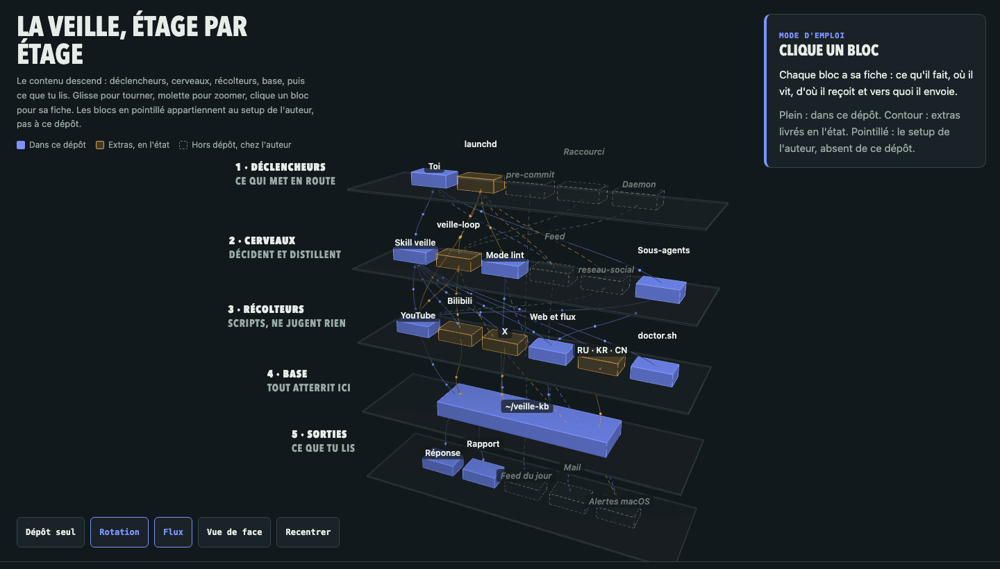

# veille

Transforme YouTube, la presse, Hacker News, GitHub, Reddit et tes flux RSS en une base de connaissance locale, en français, que tu peux interroger des mois plus tard.



Ce dépôt contient un skill pour agent de code (Claude Code, OpenCode) et les scripts qu'il appelle. Le skill n'est pas une collection de prompts : c'est une politique de rangement et de distillation, avec des mécanismes volontairement minces autour. Un dossier par sujet, des bruts archivés, des notes distillées, une synthèse qui se met à jour au lieu de s'empiler.

## Installer

```bash
git clone https://github.com/charlesDabard/veille.git
cd veille
bash install.sh
```

`install.sh` lie `~/.claude/skills/veille` vers `skill/`, crée la base de connaissances (`~/veille-kb`, dépôt git), copie les listes de sources d'exemple dans `~/.config/veille/` et compile `ytkb`. Il est relançable : un second passage ne modifie rien. Si un lien `veille` existe déjà chez toi, il refuse de l'écraser et te dit quoi faire.

Il faut `git`, `curl`, `jq`, `python3` et `yt-dlp`. Rust n'est nécessaire que pour `ytkb` (YouTube) ; sans Rust, tout le reste fonctionne et `install.sh` te donne la commande d'installation.

Vérifie que chaque source répond avant de récolter :

```bash
bash skill/doctor.sh
```

Le tableau affiche `SOURCE / ÉTAT / DÉTAIL / RÉPARATION`. Toute ligne `KO` porte la commande exacte qui la répare. `SKIP` veut dire « source optionnelle désactivée », la veille tourne sans.

## Premier run

Dans ton agent, en étant dans le dossier de ton choix :

```
/veille serveurs MCP
```

Le skill commence par une question : YouTube seul, tout, web seul, ou choix fin. Il liste ensuite les vidéos et les articles trouvés, et attend ta sélection. Rien n'est téléchargé sans ton accord.

Tu obtiens :

```
~/veille-kb/serveurs-mcp/
├── _bruts/            transcripts et articles tels quels, horodatés
├── notes/             une note par source, en français, avec une section Pertinence
├── SYNTHESIS.md       la synthèse thématique, réécrite à chaque run
└── _index.md          la liste des sources déjà ingérées
```

Relancer `/veille serveurs MCP` plus tard ne retélécharge rien : `_index.md` sert d'anti-doublon, seuls les nouveaux items passent.

## Les trois modes

**Récolter** · `/veille <sujet>` ou « fais une veille sur … ». Demande les sources, montre ce qu'il a trouvé, distille ce que tu choisis.

**Chercher** · « cherche dans ma veille : est-ce que les serveurs MCP gèrent l'authentification OAuth ? » ou « d'après ma veille, … ». Répond uniquement depuis ta base, avec les sources citées, et dit franchement quand la base ne contient pas la réponse.

**Linter** · « lint ma veille ». Contrôle de santé en lecture seule : contradictions entre notes, affirmations périmées, notes orphelines, liens morts.

## Ton propre mot magique

Les déclencheurs vivent dans la première ligne du skill, le champ `description` de `skill/SKILL.md`. Remplace `/veille` par ce que tu veux, par exemple `MON KEVIN`, et le skill répondra à « MON KEVIN serveurs MCP ». Rien d'autre à changer : les chemins sont relatifs au dépôt, la base est `~/veille-kb` ou `$VEILLE_KB`.

## Ce qui est garanti, ce qui ne l'est pas

Le cœur, c'est-à-dire `skill/SKILL.md` et les scripts à côté (`doctor.sh`, `fetch_feeds.py`, `rss2ndjson.py`, `check-merge.sh`, `agent-watch.sh`), est testé et maintenu. C'est là que vivent les 80 % du travail : YouTube, Google News, Hacker News, GitHub, Reddit, flux RSS, X par URLs collées, recherche web.

`skill/extras/` est livré **en l'état** : sources chinoises, coréennes, russes et Yandex, plus l'automatisation par `launchd`. Ça tourne sur la machine de l'auteur, sur macOS, avec des clés et des sessions de navigateur. Ce n'est pas garanti ailleurs, et `extras/README.md` dit pour chaque pièce ce qu'il faut pour la faire tourner. Lis-le avant de l'activer.

## Le guide complet

`docs/guide.html` : la carte de la veille en 3D, l'installation commentée, ce que produit la base, comment ajouter une source, comment écrire ton propre skill. Ouvre le fichier dans ton navigateur, il n'a besoin d'aucun serveur.

## Licence

MIT, voir `LICENSE`.
